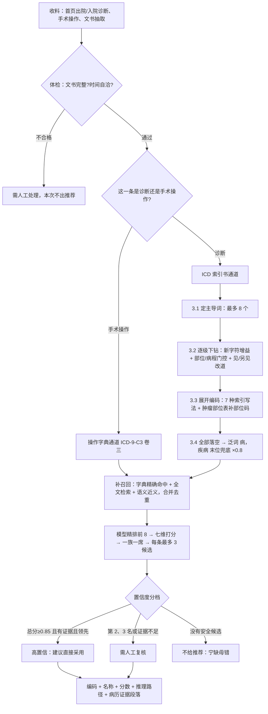

# 智能编码推荐流程说明

> 面向病案编码员 / 非技术读者的讲解稿（2026-10-15 更新，替换 9-28 版）。
> 一句话概括：**系统做的就是你翻 ICD 索引书的那套动作** —— 定主导词 → 逐级往下钻 → 把索引行上的码展开成可用码 → 再和字典精确命中、全文检索、语义近义的结果放一起比 → 打分取前 3 → 告诉你"为什么是这个码"。
> 配套可视化：`docs/智能编码推荐流程图.html`（可直接打印给病案室）。

---

## 一、整体流程

---

## 二、每一步在做什么

### 1. 收料
- 来源：首页**出院诊断**、首页**入院诊断**、**手术操作**，以及病历文书里自动抽取的诊断。
- 清洗：去掉序号、"可能性大 / 待查"这类连接噪声；识别**侧别与部位**（左/右/双侧）、**病程**（急性/慢性）、**否定**（已排除）。
- 同一条诊断在首页和文书里都出现时只编一次，优先采用首页写法。

### 2. 体检（质量门禁）
- 检查文书是否存在且非空、是否重复提交、出入院时间是否自相矛盾。
- 不合格 → 标记**「需人工处理」**，本次不出推荐结果，不会给一个"差不多"的码。

### 3. 查索引书（核心，内置 5.1 万行 ICD 索引）

| 小步 | 编码员的动作 | 系统的规则 |
|---|---|---|
| 3.1 定主导词 | 决定翻到索引书哪一页 | 词条主词、别名、括号异体都要在你的诊断名里**真的出现**（去标点、等义词换算后按字序比）；泛词（动脉/慢性/综合征…）不许当锚点；等义词先换算（霉菌病 = 真菌病、乳房 = 乳腺、癫癎 = 癫痫）；最多同时试 **8 个**主导词 |
| 3.2 逐级下钻 | 在主词下按修饰词一层层找更细 | 子节点必须带来输入的**新字符（≥2 个）**；部位门控（"腰椎"不会被带到"颈椎"分支）；急性↔慢性、近期↔陈旧不跨分支；遇**见/另见**按索引书改道，与下钻比谁覆盖输入更多；整条链路覆盖**不足 30%** 直接丢弃 |
| 3.3 展开编码 | 把索引行上写的码变成可用码 | 认 7 种索引写法（类目码、横线详码、星号剑号、范围、替代组…）；字典展开要求**标题连续覆盖诊断名 ≥60%**；**肿瘤形态学码**（M8000/3 这类只说性质不说部位）另查肿瘤部位表补出部位码 |
| 3.4 末位兜底 | 实在没有才用"病，疾病" | 只有所有具体主导词都落空时才走泛词 **病，疾病 / 疾患**；显式标注「兜底」并**降权 ×0.8**，永远排在具体链路之后 |

补充两条：**索引行上的码在字典里展不开**时，只推荐索引码本身并标注「回退」，让编码员知情；诊断侧**不做**字典名直匹配兜底（见第五节）。

### 4. 另外三路补召回
- **字典精确命中**：完全同名或命中已登记同义词 → 直接进候选，分数最高一档。
- **全文检索**：对编码知识库全文找相似标题，要求**连续覆盖 ≥0.6 且最长公共段 ≥3 字**才保留（治"字面像、临床不对"，例如神经根型腰椎病 → 糖尿病腰骶神经根病）。
- **语义近义检索**：找"说法不同、意思相同"的标题（术后状态、化疗后这类跨表述），只在诊断通道启用。
- 三路结果与索引通道合并，**同一个码只留一条**。

### 5. 排序打分
- 模型对池内**前 8 条**精排，再按**七维**加权：完全同名、语义相近、检索命中、模型精排、规则校验、病历证据、大模型复核（**证据维权重最高**）。
- **一族一席**：同一索引族（同一类目下的近亲码）只占一个位置，避免 3 个候选全是同一个码的变体。
- 每条诊断**最多交付 3 条**候选 —— 精度优先，宁少不错。

### 6. 置信度分档
- **高置信（建议直接采用）**：总分 ≥0.85、有病历证据支撑、明显领先第二名。
- **需人工复核**：第 2、3 名一律需复核；或证据不足、领先不明显。
- **不给推荐**：没有安全候选就空着 —— 空推荐好过错推荐。

### 7. 编码员在工作台看到的
- 编码 + 名称 + 分数 + 置信度档位，每条带**推理路径**（主导词 → 修饰词 → 索引节点 → 最终编码，并标明是"具体链路 / 兜底 / 回退"）。
- 带**病历原文证据段落**，可直接核对依据。
- **已确认**的编码在系统重跑时不会被覆盖，旧推荐只转成「历史版本」。
- 任一条不满意都能查"是哪一步没走通"（召回？下钻？字典展开？），可复现、可反馈。

---

## 三、案例速查：结果分四档

万台真实诊断名回归台账（2026-10-14 版本）上的分布：**口径内 6,760 条 → Top-1 精确命中 1,516 / 类目命中但码不同 1,052 / 有推荐但类目不对 3,177 / 无推荐 1,015**；按全部 1 万条 → **1,945 / 1,319 / 4,099 / 2,637**。

### ① Top-1 精确命中

| 病历原文 | 系统 Top-1 | 病案编码 | 索引链路 | 怎么读 |
|---|---|---|---|---|
| （右侧）声带息肉 | `J38.102` 声带息肉（候选 2：`J38.100` 声带和喉的息肉） | `J38.102` | 息肉 → 声带(粘液性) → `J38.1` → 展开 | 括号里的"右侧"是侧别噪声，不参与匹配；索引只钻到 `J38.1`，取 102 还是 100 由字典详码决定，编码员确认有无累及喉 |
| 十二指肠溃疡伴出血可能性大 | `K26.400X001` 十二指肠溃疡伴出血（候选 2、3：`K29.800` 十二指肠炎、`Q43.804` 先天性巨十二指肠） | `K26.400X001` | 溃疡(性) → 十二指肠 → 伴有 → 出血，并触发 `[跳转：溃疡 → 溃疡，十二指肠，伴有，出血]` | 三层下钻 + "伴有"关系 + 见/另见改道都走对；"可能性大"这类后缀被清洗；后两条是"字面沾到、临床不对"的备选 |

### ② 类目命中（多数不是错，是"细度不同"）

| 病历原文 | 系统 Top-1 | 病案编码 | 索引链路 | 怎么读 |
|---|---|---|---|---|
| 陈旧性下壁心肌梗死 | `I25.207` 陈旧性下壁心肌梗死（候选 2：`I25.200`） | `I25.200` | 梗死，梗塞 → 心肌 → 治愈的或陈旧性 → `I25.2` | 类目一致，系统给的是**更细一号**且用上了"下壁"的码；在两条里挑一条即可 |
| （颈部）淋巴结非典性增生 | `R59.000` 局限性淋巴结增大 | `R59.900` 淋巴结增大 | 增生(性) → 颈淋巴结 → `R59.0` | 索引把"颈部淋巴结增生"归局限性，病案编未特指；分歧在"能不能算局限性"，属人工裁量 |

### ③ 有推荐但类目不对：看"卡在哪一步"

| 病历原文 | 系统给的 | 病案编码 | 卡在哪 | 怎么修 |
|---|---|---|---|---|
| 胆囊继发可能性大 | `R93.204` 胆囊占位性病变（只 1 条） | `K82.900X001` 胆囊病变 | 召回到的主导词是索引里的 `无显影，胆囊`（讲的是 X 线不显影），链路覆盖仅 **0.25**，低于 30% 覆盖线 | 病历是**影像结论缩句**，索引无对应修饰词层 → 补主导词行或等义词 |
| 掌肌微黑角膜霉菌病 | 改造前 `B36.900`/`B47.100`/`B37.000`；改造后 Top-1 `B36.100X001`、第 2 `B49.X00` | `B36.100X001` | 主导词写成 `真菌病[霉菌病]，真菌性 NEC`，"霉菌病"在**括号**里属次优别名（权重 0.85），B49 被四个整词挤到第 5 名、被前 3 截断 | 补等义词 **霉菌病 = 真菌病** 后，改写文本召回整词主导词 **角膜真菌病** → Top-1 即期望码 |
| 中心细胞性淋巴瘤 | `C83.809` 等 C83.8 一族 | `C83.101` | 链路**完全走通**（淋巴瘤(恶性) → 中心细胞性，覆盖 1.00），但该行索引写的码是 `M9674/3:C83.8`；期望码在 C83.1 下，索引里指向 C83.1 的行全写成 `核裂细胞性`（M9672/3） | 由编码员裁定：补等义词「中心细胞性 = 核裂细胞性」，或补索引行 `淋巴瘤(恶性) → －中心细胞性` |

### ④ 无推荐 / 看着像没命中：分清"系统留白"与"对照码本身有问题"

| 病历原文 | 系统给的 | 病案编码 | 实测归因 | 怎么读 / 怎么修 |
|---|---|---|---|---|
| 1 型呼衰原因待查 | **无推荐** | `J96.900` 未特指的呼吸衰竭 | 只召回到泛词主导词 `原因`，其子层 `外部，全身性效应 T75.8`、`未述及(疾病) R69` 钻不出可用码；写成"呼吸衰竭"即可走通 `衰竭(全身 NEC) → 呼吸 = J96.9` → `J96.900X001/X002/X003` | **"呼衰"是简称，索引书没这一页** → 补等义词（呼衰 = 呼吸衰竭）或请临床写全称 |
| 胎盘早剥 | `O45.900X003` 重度胎盘早剥 / `O45.900` 胎盘早期剥离 / `O45.900X002` 伴出血 | 对照码写的是 `O20.000`（字典里该码名称是**先兆流产**） | 两条主导词都召回并钻通：`胎盘早剥` 独立成行 = `O45.9`；`胎盘(另见情况) → 早剥(另见 胎盘早剥)` 改道成功，覆盖 1.00 | **假未命中** —— 对照源编码与诊断名不相符；看命中率榜单要先验"名码是否相符"，否则会把系统算低 |

---

## 四、关键设计原则

| 原则 | 说明 |
|---|---|
| **宁缺毋错** | 没有安全候选就返回 0 条，不给"差不多"的码；空推荐好过错推荐 |
| **可解释** | 每条推荐带推理路径 + 病历证据段落，编码员能复核、能反馈 |
| **按索引书规则** | 不是字符串相似度，而是遵循 ICD 索引的层级、跳转、星号/剑号、形态学码规范 |
| **改动必过万名回归** | 任何规则调整先跑 1 万条离线台账，硬线是**不允许任何一条输入因改动而失去推荐** |

---

## 五、为什么"字典里有这个码"不等于"系统能推荐它"

诊断侧**不做**字典名直匹配兜底（这是已确认的设计决策）：编码只能来自索引链路或检索通道。所以出现"病案码名字一模一样，系统却没推荐"时，通常是下面四种情况之一，按第三节的案例表对照即可判定：

1. **索引词面 ≠ 病历写法**（简称、异体字、旧译名）→ 补等义词；
2. **索引那一行写的码属于另一个类目** → 需要编码员裁定补索引行还是补等义词；
3. **链路覆盖度不够被主动丢弃** → 病历写的是检查结论缩句，需补主导词；
4. **对照码本身与诊断名不符** → 属语料问题，不是系统问题。

想复现任意一条：离线诊断工具 `tools/IcdIndexDiag` 支持逐名打印"召回了哪些主导词、每个子层为什么被剔除、最终展开成哪些码"，把诊断名发给开发即可。

---

## 六、数据来源

- 系统输出：`logs/batch_1014_conn4_jzey.tsv`（1 万条临床诊断名离线台账，2026-10-14 代码）。
- 病案对照码：`data/exports/2026-10-08-精度口径-逐名台账.tsv`。
- 重算脚本：`logs/tally_1015.mjs`（四档分布）、`logs/pick_cases_1015.mjs`（逐档挑案例）。
- 口径定义：`docs/2026-10-08-精度验收口径规范.md`（L0 全量 / L1 口径内，剔除判据 E1–E5）。
