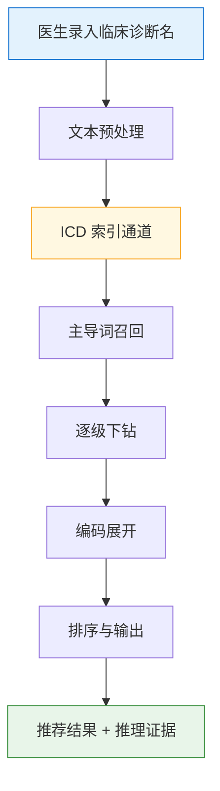

# 智能编码推荐流程说明

> 面向非技术领导的简明讲解稿。一句话概括：**系统把医生写的诊断名,按 ICD 索引书的规则"查目录 → 下钻 → 展开编码",输出最匹配的 1–3 条 ICD 编码及推理路径。**

---

## 一、整体流程

---

## 二、每一步做什么

### 1. 医生录入临床诊断名
- 来源:首页入院诊断、出院诊断、手术操作,或病历文书自动抽取
- 形式:纯文本,如"左肺微小结节并钙化""慢性阻塞性肺病"

### 2. 文本预处理
- 去除书写噪声(序号、括号标注、"原因待查"类连接词)
- 识别病程(急性/慢性)、否定(排除XX)、部位(左/右/双侧)

### 3. ICD 索引通道(核心)

系统内置一本 **5.1 万行的 ICD 索引书**,流程完全模拟编码员"翻索引书"的动作:

#### 3.1 主导词召回 —— "翻到索引书的哪一页"
- 把索引书中每个词条的主词、别名、修饰词全部展开
- 用别名去匹配医生输入,要求**覆盖输入 ≥ 60% 的关键字符**(防止"肺炎"匹配到"肺炎球菌性脑膜炎")
- 黑名单过滤:泛化词(动脉/血管/慢性/急性等)不得作为主导词锚点

#### 3.2 逐级下钻 —— "在子目录里继续找更细的分类"
- 子节点必须带来输入的**新内容**(≥2 个新字符),防止被无关子目录带走
- 部位门控:节点声明的部位必须是输入已声明的子集(治"肌断裂→视网膜断裂"类误钻)
- 病程互斥:急性↔慢性、近期↔陈旧 不可跨分支
- "见 X"跳转与下钻竞争,取覆盖输入更多者

#### 3.3 编码展开 —— "把索引条目变成具体 ICD 码"
- 支持 7 种索引编码格式(类目、横线详码、星号、范围、替代组等)
- 通过本地 ICD 字典展开为最终编码
- 展不开时回退推荐索引编码本身,并**显式标注"回退"**,让编码员知情

### 4. 排序与输出
- 按"对输入的覆盖度"未截断排序,避免同分被召回顺序左右
- 每个诊断输入输出 **Top 1–3** 条推荐

### 5. 推荐结果 + 推理证据
- 每条推荐附带完整路径:**主导词 → 修饰词 → 索引节点 → 最终编码**
- 编码员可一键查看推理依据,而非黑箱

---

## 三、关键设计原则

| 原则 | 说明 |
|---|---|
| **宁缺毋错** | 找不到匹配时返回 0 条推荐,而不是给一条"差不多"的错码 |
| **可解释** | 每条推荐都有可读的推理路径,编码员能复核 |
| **按索引书规则** | 不是字符串相似度,而是完全遵循 ICD 索引书的层级、跳转、星号等规范 |
| **双通道兜底** | 主通道为 ICD 索引;字典直匹配作为兜底,覆盖率 100% |

---

## 四、万级真实数据验证

用 **10000 条真实临床诊断名**(来自病案系统)做回归测试,对照病案原始编码:

| 指标 | 数值 |
|---|---|
| Top-1 命中率(绝对) | **9.1%** |
| Top-3 命中率(绝对) | **13.2%** |
| 类目级 Top-1 命中率 | **23.0%** |
| 有推荐的输入中,Top-1 命中 | 13.8% |
| 有推荐的输入中,Top-3 命中 | 20.0% |

> 剩余未命中主要来自:症状+"待查"类模糊表述、跨章节的医生判断码(如"化疗后→Z51.1"),这类需要语义理解或 LLM 辅助,是下一阶段向量检索 + LLM 接入要解决的问题。

---

## 五、一句话总结

> **系统 = 一本会自己翻的 ICD 索引书 + 一套严格的匹配规则 + 一条可追溯的推理链。**
> 医生写诊断名,系统按索引书规则给出 1–3 条最可能的 ICD 码,并告诉编码员"为什么是这个码"。
